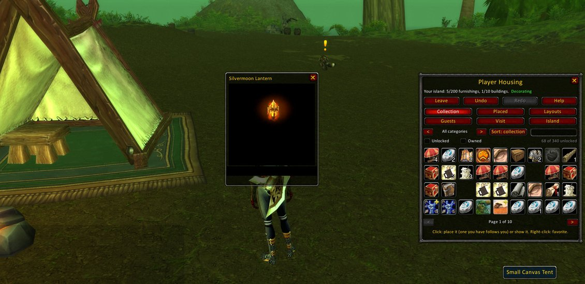
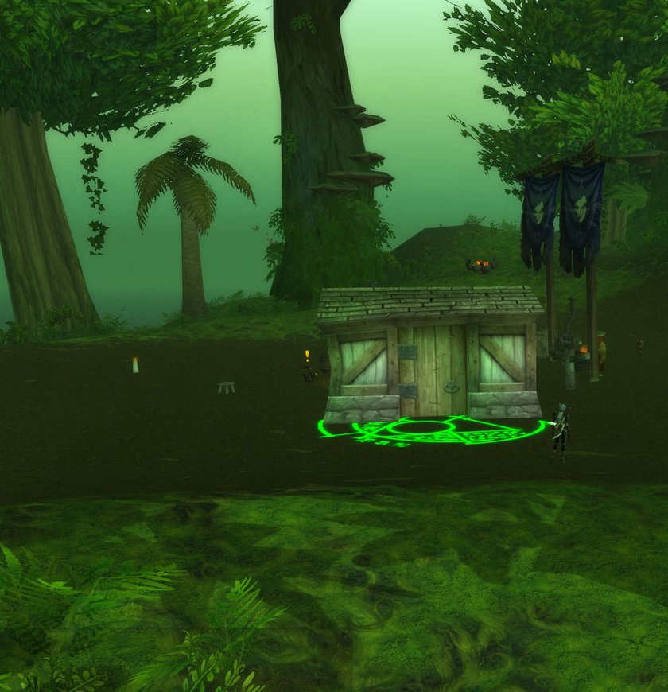
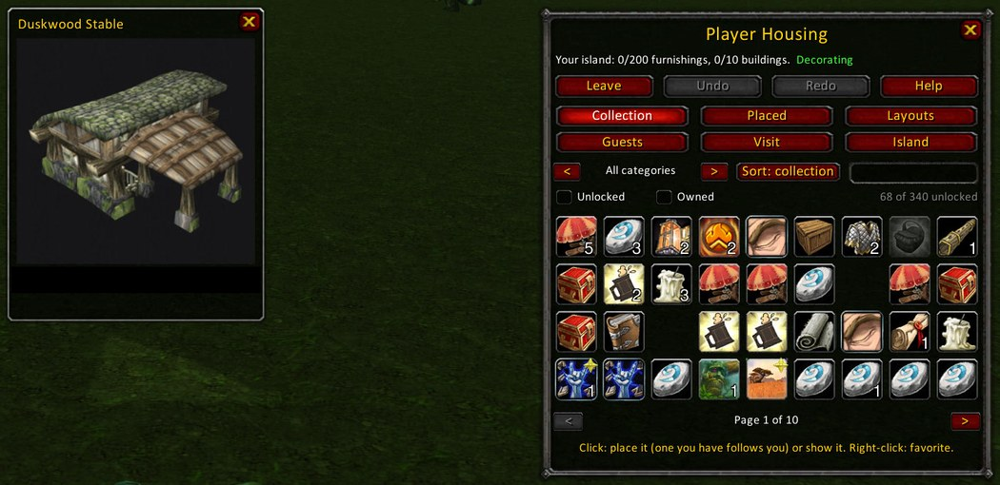

# Player Housing (mod-playerhousing)

**Author:** [dudemcbro](https://github.com/dudemcbro) | **License:** GNU AGPL v3.0 |
**Works with:** AzerothCore WotLK (3.3.5a)

Player housing for AzerothCore (WotLK 3.3.5a), modeled on Lord of the Rings Online and Final
Fantasy XIV without the neighborhoods. Every account gets one private copy of GM Island,
shared by all its characters. Click a furnishing or building in the Collection, click where
it should go, done. Every change can be undone, and anything picked up returns to the shared
Collection without taking bag space.
What you can own grows as you play: exploring, dungeons, raids, reputation, professions and
holidays all add pieces to your Collection, and buildings climb from a broken cart and a
shredded tent at level 1 to faction halls at Exalted.

  

  
  

**Features:** a private island per account; 2,350+ furnishings, buildings and figurines
unlocked by playing; placing, turning, tilting and resizing with the mouse, on floors, table
tops, walls and ceilings; undo for everything; saved layouts and sets; mannequins that wear
your real gear; weather, time of day and music per island; visitors, likes, a guestbook and
roommates; GM moderation tools.

## Future features

- More player housing islands and areas
- Improved object controls
- Progression and people: more collectibles
- Mannequins: poses, weapons drawn or sheathed, mount and pet stands
- Guild islands

## Setting it up

- **Players:** get your server's download and follow [Player setup](docs/PLAYER_SETUP.md):
  unzip, start the game with the launcher, and ask Krook at any capital's inn for a House
  Key.
- **Server admins:** [Server setup](docs/SERVER_SETUP.md) takes you from an AzerothCore
  server to the download your players need. No core patches; stock AzerothCore should work
  as well as the playerbots fork it's developed on.
- **Downloads:** each [release](https://github.com/dudemcbro/mod-playerhousing/releases) has
  the addon, `PlayerHousing.dll` and its launcher. The client patch is built from game files,
  so it comes from each server rather than from here.
- **Trying it out:** the [test server](tools/test-server/README.md) runs everything in a
  container.

## Documentation

| | |
| --- | --- |
| [Player setup](docs/PLAYER_SETUP.md) | Getting the game ready: the download, the launcher, Krook's House Key |
| [Player guide](docs/PLAYER_GUIDE.md) | Placing and changing pieces, layouts, mannequins, the Collection, visitors and roommates |
| [Server setup](docs/SERVER_SETUP.md) | Installing, every setting, updating, uninstalling, troubleshooting |
| [Commands](docs/COMMANDS.md) | Every `.house` command and the GM tools |
| [Client addon](docs/ADDON.md) | The housing window, the mouse and keys, building pictures |
| [Unlocks](docs/UNLOCKS.md) | Every piece and what unlocks it |
| [Content](docs/CONTENT.md) | Where the pieces come from, and changing them |
| [Krook's voice](docs/KROOK.md) | How Krook talks: the rules for any line he says, writes or mails |
| [Design](docs/DESIGN.md) | The ground rules and the decisions behind them |
| [How it works](docs/HOW_IT_WORKS.md) | Phases, ghosts, undo, safety rules, load measurements |
| [Roadmap](docs/ROADMAP.md) | What's planned on the way to 2.0 |
| [Test server](tools/test-server/README.md) | A complete server in a container, and the end-to-end tests |

## Contributing

Issues and pull requests are welcome. Work on a feature branch and open the pull request
against `main`. Commit messages follow
[Conventional Commits](https://www.conventionalcommits.org/) (`fix: ...`, `feat: ...`,
`docs: ...`). Run the end-to-end test from [tools/test-server](tools/test-server/README.md)
(and `client-addon/test/harness.lua` for addon changes) before opening a pull request.
Content changes go in `tools/content/pieces.py`; regenerate the SQL, `docs/UNLOCKS.md`
and the addon lists with `tools/content/build_content.py` rather than editing them by hand.
Anything Krook says, writes or mails follows his [voice guide](docs/KROOK.md).

## How this was made

Player Housing is designed and directed by [dudemcbro](https://github.com/dudemcbro) and
written largely with AI coding assistants: Anthropic's Claude, through Claude Code. Commits
made with it carry a `Co-Authored-By` line naming the model. Every change is checked by
the end-to-end test and the addon harness in this repository, and the module runs on a live
server where it is played and tried in the game.

## License

GNU Affero General Public License v3.0: see [LICENSE](LICENSE). The bundled
[MinHook](client-dll/minhook/LICENSE.txt) sources keep their own BSD license.
